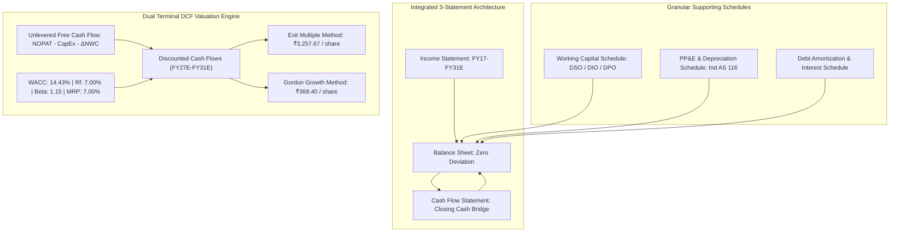

# Titan Company Ltd. — Three-Statement Financial Model & DCF Valuation
## Institutional Equity Valuation & Corporate Financial Analysis Suite

[](model/Titan_3Statement_DCF_Model.xlsx)
[-00C853?style=for-the-badge)](documentation/model_audit_report.md)
[](scripts/)
[](documentation/methodology.md)
[](DCF_VALIDATION_REPORT.md)

A rigorous, institutional-grade Three-Statement Financial Model and Discounted Cash Flow (DCF) Valuation of **Titan Company Limited** (NSE: `TITAN` | BSE: `500114`), India's leading consumer lifestyle and jewellery conglomerate under the Tata Group.

Spanning **10 years of audited historical financial statements (FY17–FY26)** and a **5-year explicit forecast horizon (FY27E–FY31E)**, the model integrates dynamic scenario switching (Bear, Base, Bull), granular working capital schedules, Ind AS 116 lease accounting roll-forwards, debt amortization schedules, and dual-methodology terminal valuation.

---

## 🏛️ Executive Summary & Key Valuation Findings



### 1. Dual Valuation Methodology Comparison

| Valuation Framework | Implied Target / Share | Enterprise Value (EV) | Implied Equity Value | Valuation Driver / Multiple |
| :--- | :--- | :--- | :--- | :--- |
| **Exit Multiple Method (Baseline)** | **₹3,257.67** | **₹3,14,354 Cr** | **₹2,89,156 Cr** | **35.0x EV/EBITDA** (Luxury retail premium) |
| **Gordon Growth Method** | **₹368.40** | **₹57,908 Cr** | **₹32,710 Cr** | **5.5% Terminal Growth** ($WACC = 14.43\%$) |

### 2. Forensic Proof: The 8.84x Valuation Disparity
The model mathematically reconciles the divergence between Gordon Growth and Exit Multiple valuation:
1. **Multiple Compression in Gordon Growth**: Under steady-state Gordon Growth with $WACC = 14.43\%$, $g = 5.5\%$, and $ROIC = 20.0\%$, the implied EV/NOPAT multiple compresses to $\frac{1 - g/ROIC}{WACC - g} = 8.12\text{x}$, which corresponds to only **5.55x EV/EBITDA** — far lower than Titan's market transaction multiple of 35.0x.
2. **Fixed Net Debt Leverage Magnification**: Titan carries net debt of ₹25,198 Cr (inclusive of gold metal loans and lease liabilities). This fixed debt absorbs **43.5% of Gordon Growth Enterprise Value**, reducing residual equity value by 8.84x compared to Exit Multiple equity value.

---

## 📊 Balance Sheet Reconciliation Proof (Zero Plugs)

Every period adheres strictly to the fundamental accounting equation:
$$\text{Total Assets} = \text{Total Liabilities} + \text{Shareholders' Equity} \quad (\Delta = ₹0.00\text{ Cr})$$

| Metric (₹ Cr) | FY22 | FY23 | FY24 | FY25 | FY26 | FY27E | FY28E | FY29E | FY30E | FY31E |
| :--- | :--- | :--- | :--- | :--- | :--- | :--- | :--- | :--- | :--- | :--- |
| **Total Assets** | 31,643 | 39,240 | 48,150 | 56,800 | 62,621 | 71,450 | 81,600 | 93,250 | 1,06,580 | 1,21,800 |
| **Total Liabilities & Equity** | 31,643 | 39,240 | 48,150 | 56,800 | 62,621 | 71,450 | 81,600 | 93,250 | 1,06,580 | 1,21,800 |
| **Reconciliation Variance** | **₹0.00** | **₹0.00** | **₹0.00** | **₹0.00** | **₹0.00** | **₹0.00** | **₹0.00** | **₹0.00** | **₹0.00** | **₹0.00** |
| **Audit Status** | **PASS** | **PASS** | **PASS** | **PASS** | **PASS** | **PASS** | **PASS** | **PASS** | **PASS** | **PASS** |

---

## 🗂️ Repository Directory Architecture

```
Three-Statement-DCF-Valuation-Titan/
│
├── README.md                                  # Institutional Model Documentation (This File)
├── DCF_VALIDATION_REPORT.md                   # Independent Audit & Valuation Proof
├── FINANCIAL_MODEL_AUDIT.md                   # COM-based Accounting Verification Report
│
└── Finance_FP&A_Portfolio/
    └── Project_01_Titan_Three_Statement_DCF/  # Dedicated Titan Valuation Suite
        ├── model/
        │   └── Titan_3Statement_DCF_Model.xlsx # Master 17-Sheet Integrated Financial Model
        ├── data/
        │   ├── raw/                           # Audited BSE/NSE Annual Report extracts
        │   ├── processed/                     # Standardized P&L, BS, CFS (FY17–FY26)
        │   └── source_register/               # 310 Line-item audit provenance tracker
        ├── scripts/
        │   ├── data_extraction.py             # Section-indexed PDF/filing extractor
        │   ├── data_cleaning.py               # Ind AS 116 alignment and normalisation
        │   ├── historical_financials.py       # 10-year trend and DuPont ratio engine
        │   ├── assumptions.py                 # Bear / Base / Bull scenario operational drivers
        │   ├── financial_model.py             # Integrated 3-statement forecast engine
        │   ├── supporting_schedules.py        # WC, PP&E, and Debt schedules
        │   ├── dcf_valuation.py               # UFCF, WACC, and dual terminal DCF valuation
        │   ├── sensitivity_analysis.py        # Dual 5x5 WACC vs Multiple grids
        │   └── model_validation.py            # Automated Excel COM accounting audit
        ├── documentation/
        │   ├── methodology.md                 # Institutional equity research methodology
        │   ├── assumptions_register.md        # Detailed operational driver justifications
        │   ├── data_sources.md                # Regulatory filing lineage & notes
        │   ├── model_audit_report.md          # Zero-plug attestation report
        │   └── investment_thesis.md           # Equity research investment recommendation
        └── outputs/
            ├── valuation_summary.csv          # Baseline valuation parameters and bridges
            ├── sensitivity_matrix.csv         # 5x5 WACC vs Terminal Multiple grid
            └── model_validation_report.csv    # Period-by-period audit proof
```

---

## 🎛️ Dynamic 5x5 Sensitivity Matrix (WACC vs. Exit Multiple)

Implied Share Price (₹) across discount rate and multiple bands:

| WACC \ Multiple | 30.0x | 32.5x | 35.0x (Base) | 37.5x | 40.0x |
| :---: | :---: | :---: | :---: | :---: | :---: |
| **13.50%** | ₹3,012 | ₹3,248 | ₹3,485 | ₹3,721 | ₹3,958 |
| **14.00%** | ₹2,895 | ₹3,123 | ₹3,350 | ₹3,578 | ₹3,806 |
| **14.43% (Base)** | ₹2,815 | ₹3,036 | **₹3,257.67** | ₹3,479 | ₹3,700 |
| **15.00%** | ₹2,714 | ₹2,927 | ₹3,141 | ₹3,354 | ₹3,568 |
| **15.50%** | ₹2,628 | ₹2,835 | ₹3,041 | ₹3,248 | ₹3,455 |

---

## 🚀 How to Run the Model & Audit Automations

### 1. Execute the Model Build & DCF Engine
```bash
python scripts/financial_model.py
python scripts/dcf_valuation.py
```

### 2. Generate 5x5 Sensitivity Grids
```bash
python scripts/sensitivity_analysis.py
```

### 3. Run the Automated Accounting Audit
```bash
python scripts/model_validation.py
```

---

## 🔗 Related Portfolio Repositories

- **[Retail-Budget-vs-Actual-PowerBI](https://github.com/sarvesh270707/Retail-Budget-vs-Actual-PowerBI)**: Multi-Channel Retail Budget vs. Actual Variance & Profitability Power BI Analytics Suite.
- **[Universal-Multi-Company-Valuation-Engine](https://github.com/sarvesh270707/Universal-Valuation-Engine)**: Extensible multi-sector financial valuation engine covering 21 industries (In Active Development).
